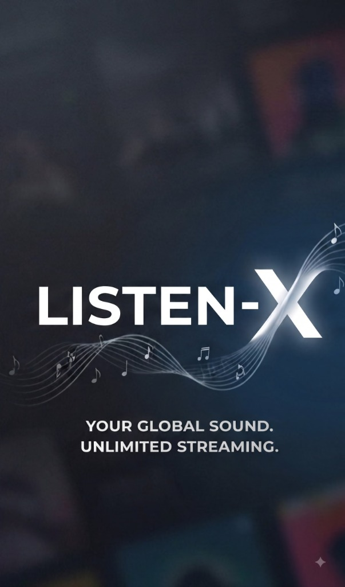

# 🎵 Listen-X Web — Futuristic Liquid Glass Music Player & Universal Audio Streamer

<p align="center">
  
</p>

<p align="center">
  <b>High-Fidelity 320kbps Audio • Dynamic Liquid Glass Design System • Synced Lyrics • 6-Band Equalizer • Laptop & Cloud Streaming</b>
</p>

---

## 🌟 Overview

**Listen-X Web** brings the full futuristic Liquid Glass music experience from the mobile app to desktop, tablet, and mobile web browsers. Engineered with pure modern web technologies (HTML5, Web Audio API, CSS3 Glassmorphism, and ES Modules), it streams high-fidelity 320kbps tracks from JioSaavn, displays real-time LRCLIB synchronized lyrics, tunes sound via a 6-band graphic DSP equalizer, and connects seamlessly to your laptop's local `D:\music` collection via `listenx_server.py`.

*(Note: In accordance with project architecture, the video player system is exclusive to the mobile app and is omitted from the web player).*

---

## ✨ Features

### 🎨 1. Fluid Dynamic Design System
- **Liquid Glass UI & Frosted Glass Surfaces**: Translucent floating cards with `backdrop-filter: blur(24px)`, subtle neon borders, glowing neon cyan (`#00F0FF`) and purple (`#8A2BE2`) highlights.
- **3 Adaptive Performance & Visual Modes**:
  - **🌊 Ultra Liquid (High)**: Procedural real-time animated neon fluid mesh background on HTML5 canvas with morphing luminous blobs and responsive auras.
  - **⚖️ Balanced (Medium)**: Translucent glass surfaces, soft CSS gradients, and fluid micro-animations.
  - **⚡ Performance (Low)**: Ultra-minimal flat dark AMOLED UI with zero canvas animations, engineered for battery saving.
- **🖼️ App-Wide Custom Wallpaper Background**: Upload any high-res photo from your computer/device or enter an image URL with an automatic dark frosted scrim overlay.

### 🎧 2. Audio Engine & DSP Tuning
- **Web Audio API 32-bit Pipeline**: Direct low-latency hardware-accelerated audio processing.
- **🎚️ 6-Band Graphic Equalizer & Preamp**:
  - Frequencies: 60Hz (Sub-Bass), 230Hz (Bass), 910Hz (Mid-range), 3.6kHz (Presence), 14kHz (Brilliance), plus Preamp Gain (-12dB to +12dB).
  - Presets: Flat, Bass Boost, Vocal, Electronic, Rock, Pop.
- **🎤 Karaoke Vocal Remover DSP**: Center-channel audio subtraction (L - R phase inversion) to attenuate lead vocals.
- **🎛️ Real-Time DJ Crossfader**: Adjustable 0s to 12s smooth transition between ending and incoming tracks.
- **✨ Active Track Spectrum Visualizer**: Live bouncing equalizer soundwaves on the mini player and full spectrum analyzer on the Now Playing sheet.
- **⏩ Variable Playback Speed**: 0.75x, 1.0x, 1.25x, 1.5x, 2.0x.

### 🎶 3. Music Discovery & Streaming Engine
- **Direct 320kbps Audio Decryption**: Embedded pure JavaScript DES-ECB decryptor translating JioSaavn encrypted CDN URLs into high-fidelity 320kbps streams.
- **Multi-Category Dynamic Catalog**:
  - **Trending Hits**: Blends top trending tracks with your personalized music taste profile.
  - **Haryanvi Blast**: Masoom Sharma, Gulzaar Chhaniwala, Renuka Panwar, Amit Saini Rohtakiya, KD Desi Rock, Diler Kharkiya, etc.
  - **Punjabi Hits**: Sidhu Moosewala, Karan Aujla, Diljit Dosanjh, AP Dhillon, Shubh, etc.
  - **Bollywood Chartbusters**: Arijit Singh, Shreya Ghoshal, Atif Aslam, Jubin Nautiyal, etc.
  - **International Pop**: Taylor Swift, Ed Sheeran, The Weeknd, Dua Lipa, etc.
  - **Midnight LoFi**: LoFi chill Hindi, acoustic, and aesthetic midnight mixes.
- **Quick Artist Pills**: Horizontally scrollable singer tags for instant 1-tap discography search.
- **🔀 In-Place Randomization Engine**: One-tap "Shuffle Order" button randomizes and rearranges the visible list in real time without stopping current playback.
- **🔍 Real-Time Debounced Live Search**: Instant search as you type.

### 📜 4. Real-Time Synced Lyrics
- **Synchronized LRC Support**: Connects to LRCLIB and JioSaavn official lyrics APIs.
- **Interactive Lyric Lines**: Active singing line is highlighted with an enlarged cyan glow; clicking any lyric line seeks playback directly to that second!
- **Auto-Scroll Engine**: Smoothly centers the currently sung line with intelligent user-scroll pause detection.
- **One-Tap Lyrics Copy**: Copy raw plain lyrics directly to clipboard.

### 💻 5. Laptop Streamer & Local Files
- **Laptop D:\music Server**: Connects to `listenx_server.py` (`http://localhost:8080` or public Cloudflare tunnel) to browse and stream your PC collection anywhere.
- **Offline Local Audio Ingestion**: Drag & drop or pick MP3, M4A, FLAC, and WAV files directly from your computer to play instantly offline.

### 📁 6. Playlists & Library Management
- **Liked Songs / Favorites**: One-click hearting saved to persistent `localStorage`.
- **Custom Playlists**: Create, name, organize, and delete personalized playlists.
- **Listening History**: Tracks recently played songs with timestamps.
- **Instant Audio Downloader**: Download any 320kbps song directly as an audio file with proper metadata filename.

---

## 🚀 Running the Web Player

### Method A: Built-in Python Server (Recommended)
`listenx_server.py` now automatically hosts `listen-web` on port 8080!
```bash
python listenx_server.py
```
Open your browser to:
👉 **`http://localhost:8080`**

### Method B: Vite Modern Dev Server
```bash
cd listen-web
npm install
npm run dev
```
Open your browser to:
👉 **`http://localhost:3000`**

### Method C: Any Static Web Server
```bash
cd listen-web
python -m http.server 5500
```
Open your browser to:
👉 **`http://localhost:5500`**

---

## 📂 Project Structure

```
listen-web/
├── index.html                   # HTML5 Entry Shell
├── package.json                 # Node & Vite configuration
├── vite.config.js               # Dev server & proxy settings
├── README.md                    # Documentation
├── assets/
│   ├── favicon.svg              # Neon cyan/purple branding icon
│   └── splash_banner.png        # High-resolution splash banner
└── src/
    ├── css/
    │   └── style.css            # Liquid Glass Design System
    └── js/
        ├── app.js               # Application Controller & Navigation
        ├── crypto/
        │   └── des.js           # Pure JS DES-ECB 320kbps Decryptor
        ├── services/
        │   ├── api.js           # JioSaavn, LRCLIB & Server API
        │   ├── audioPlayer.js   # Web Audio Engine & 6-Band EQ
        │   ├── lrcParser.js     # Synchronized LRC Parser
        │   └── storage.js       # LocalStorage State Persistence
        └── components/
            ├── liquidBackground.js # Canvas Animated Neon Fluid Mesh
            ├── visualizer.js       # Real-time Spectrum Visualizer
            ├── onlineView.js       # Search, Trending & Categories
            ├── playlistView.js     # Playlists, Laptop & Local files
            ├── nowPlayingSheet.js  # Floating Mini & Fullscreen Sheet
            ├── equalizerModal.js   # 6-Band Graphic Equalizer Modal
            └── settingsModal.js    # Graphics, Wallpaper & Preferences
```
